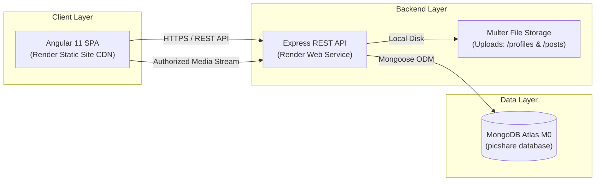

# PicShare 📸

> An elegant, Instagram-inspired full-stack social media application built with **Angular 11**, **Node.js**, **Express.js**, and **MongoDB Atlas**.

[](https://picshare-client.onrender.com)
[-brightgreen?style=for-the-badge&logo=express)](https://picshare-api-0xlf.onrender.com/api/health)
[](https://angular.io/)
[](https://nodejs.org/)
[](https://www.mongodb.com/cloud/atlas)

---

## 🌐 Public Live URLs

- **Frontend Client (Web App)**: [https://picshare-client.onrender.com](https://picshare-client.onrender.com)
- **Backend REST API**: [https://picshare-api-0xlf.onrender.com](https://picshare-api-0xlf.onrender.com)
- **API Health Check**: [https://picshare-api-0xlf.onrender.com/api/health](https://picshare-api-0xlf.onrender.com/api/health)

---

## ✨ Features

### 🔐 Authentication & Security
- **Registration**: Email, alphanumeric username, and password validation with uniqueness verification.
- **Secure Password Hashing**: Passwords encrypted using `bcrypt` with salt rounds.
- **JWT Session Management**: Signed JSON Web Tokens with client-side HTTP Interceptors and automatic session recovery.
- **Protected Routes**: Angular Route Guards (`AuthGuard`, `GuestGuard`) preventing unauthorized page navigation.

### 👤 Profile & Customization
- **Profile Header**: Avatar picture, username, display name, bio, and live counts for Posts, Followers, and Following.
- **Avatar Management**: Multipart photo uploader with client-side preview, MIME validation, and square cropping.
- **Edit Profile**: Update display name, bio, and toggle account privacy (Public / Private).

### 🖼️ Feed & Content Sharing
- **Create Post**: Drag-and-drop or file picker photo uploader with preview and caption input (up to 2,200 characters).
- **Home Feed**: Dynamic chronological feed displaying photographs, creator avatars, relative timestamps, and expandable captions.
- **Explore Grid**: 3-column square aspect-ratio photography grid with hover overlays displaying like and comment metrics.
- **Post Management**: Post owners can permanently delete their own posts, automatically purging image files and comments.

### ❤️ Interactions & Social
- **Likes**: Heart toggle with instant like count updates.
- **Comments**: Inline commenting system on post cards and detail views.
- **User Search**: Search users by username with instant avatar cards.
- **Follow System**: Follow/unfollow public accounts, or send follow requests to private accounts.
- **Followers & Following Lists**: Contextual follower management with remove capabilities for account owners.

### 🔒 Privacy Controls & Private Accounts
- **Private Profiles**: Non-followers cannot see published posts or follower lists of private accounts.
- **Follow Request Workflow**: Private account owners receive follow requests with dedicated **Accept** and **Reject** actions.
- **Protected Media Endpoints**: Private photographs are served through authorized API routes (`/api/media/posts/:filename`) requiring token verification. Direct unauthorized access returns `403 Forbidden` / `401 Unauthorized`.

### 🔔 Notifications & Settings
- **Activity Notifications**: Real-time notifications for likes, comments, follow requests, and follow approvals.
- **Unread Badge**: Global navigation badge counter with "Mark all as read" capability.
- **Security Settings**: In-app password change form and permanent account deletion confirmation modal requiring password re-verification.

---

## 🛠️ Technology Stack

| Layer | Technology | Details |
| :--- | :--- | :--- |
| **Frontend** | Angular 11 | TypeScript 4.1, HTML5, CSS3, RxJS 6.6, Angular Router, HttpClient |
| **Design System** | Custom Editorial Warm Neutral | Alegreya serif display headings, DM Sans body, warm palette (`#FAF8F5`, `#9A7655`, `#29251F`) |
| **Backend** | Node.js & Express | Express 4.17, CommonJS, REST APIs, custom middleware |
| **Authentication** | JWT & bcrypt | `jsonwebtoken`, `bcrypt` password hashing |
| **File Uploads** | Multer | Multipart upload handling, file type filters (JPG/PNG), 5 MB limits |
| **Database** | MongoDB Atlas | Mongoose 5.13 ODM, M0 Free Cluster |
| **Hosting** | Render | Render Static Site (Frontend CDN) + Render Web Service (Backend API) |

---

## 🏛️ Architecture



---

## 📁 Project Directory Structure

```text
PicShare/
├── PicShare/
│   ├── backend/                     # Express REST API
│   │   ├── config/                  # Database and environment configurations
│   │   ├── controllers/             # API request handlers (auth, post, user, etc.)
│   │   ├── middleware/              # Auth, authorization, error & upload middleware
│   │   ├── models/                  # Mongoose schemas (User, Post, Follow, etc.)
│   │   ├── routes/                  # Express route definitions
│   │   ├── uploads/                 # Storage for profile photos and post images
│   │   ├── utils/                   # Helpers, ApiError, mediaUrl builders
│   │   ├── server.js                # Server entry point
│   │   └── package.json
│   │
│   └── frontend/
│       └── picshare-client/         # Angular 11 Single Page Application
│           ├── src/
│           │   ├── app/
│           │   │   ├── core/        # Guards, HTTP interceptors, services, models
│           │   │   ├── features/    # Auth, feed, profile, social, search, etc.
│           │   │   ├── layout/      # Responsive desktop sidebar & mobile navbar
│           │   │   └── shared/      # Components (post-card, user-avatar, modal, etc.)
│           │   ├── environments/    # Environment configurations (dev & prod)
│           │   └── styles.css       # Global design system & theme variables
│           ├── angular.json
│           └── package.json
│
├── render.yaml                      # Render Blueprint deployment configuration
└── README.md
```

---

## 🚀 Running Locally

### Prerequisites
- [Node.js](https://nodejs.org/) (v18 or v20 LTS recommended)
- [MongoDB](https://www.mongodb.com/) (Local instance running at `mongodb://127.0.0.1:27017` or Atlas connection string)
- [Git](https://git-scm.com/)

### 1. Clone the Repository
```bash
git clone https://github.com/yamuna220/Picshare.git
cd Picshare
```

### 2. Configure Backend Environment
Create a `.env` file in `PicShare/backend/`:
```env
PORT=5000
NODE_ENV=development
MONGO_URI=mongodb://127.0.0.1:27017/picshare
JWT_SECRET=your_super_secret_development_jwt_key
JWT_EXPIRES_IN=7d
CLIENT_URL=http://localhost:3000
MAX_FILE_SIZE_BYTES=5242880
UPLOAD_DIR=./uploads
```

### 3. Start the Backend API
```bash
cd PicShare/backend
npm install
npm start
```
The API will run at `http://localhost:5000`.

### 4. Start the Angular Frontend
In a new terminal:
```bash
cd PicShare/frontend/picshare-client
npm install
npm start
```
The application will be accessible at `http://localhost:3000`. The development server automatically proxies `/api` calls to port `5000`.

---

## 📡 API Reference

| Method | Endpoint | Description | Auth Required |
| :--- | :--- | :--- | :---: |
| **POST** | `/api/auth/register` | Register a new user account | No |
| **POST** | `/api/auth/login` | Log in and receive JWT token | No |
| **GET** | `/api/auth/me` | Fetch currently authenticated user | Yes |
| **PUT** | `/api/auth/password` | Change user password | Yes |
| **GET** | `/api/posts/feed` | Get chronological home feed | Yes |
| **GET** | `/api/posts/explore` | Get explore photo grid | Yes |
| **POST** | `/api/posts` | Create new photo post (multipart) | Yes |
| **GET** | `/api/posts/:id` | Get post details and comments | Yes |
| **DELETE**| `/api/posts/:id` | Delete owned post | Yes |
| **POST** | `/api/posts/:id/like` | Like a post | Yes |
| **DELETE**| `/api/posts/:id/like` | Unlike a post | Yes |
| **POST** | `/api/posts/:id/comments` | Add comment to post | Yes |
| **GET** | `/api/users/me` | Get profile details | Yes |
| **PUT** | `/api/users/me` | Update bio, display name, privacy | Yes |
| **PUT** | `/api/users/me/profile-picture` | Upload profile avatar | Yes |
| **DELETE**| `/api/users/me` | Delete own account | Yes |
| **GET** | `/api/users/search?q=:query` | Search user profiles | Yes |
| **GET** | `/api/users/:username` | View another user's profile | Yes |
| **POST** | `/api/follows/:userId` | Follow or request to follow | Yes |
| **DELETE**| `/api/follows/:userId` | Unfollow user | Yes |
| **GET** | `/api/follows/requests` | List pending follow requests | Yes |
| **POST** | `/api/follows/requests/:id/accept` | Accept follow request | Yes |
| **POST** | `/api/follows/requests/:id/reject` | Reject follow request | Yes |
| **GET** | `/api/notifications` | Fetch user notifications | Yes |
| **PUT** | `/api/notifications/read-all` | Mark all notifications as read | Yes |
| **GET** | `/api/media/profiles/:filename` | Authorized avatar retrieval | No |
| **GET** | `/api/media/posts/:filename` | Authorized post photo retrieval | Optional / Enforced |
| **GET** | `/api/health` | Health check & DB status | No |

---

## 📄 License

This project is licensed under the MIT License.
